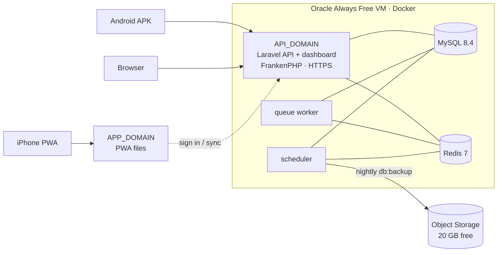

# 🏠 Home Helper

**One free app for the whole household.** Shopping list, kitchen, money, chores, planner, food, activity and weather, shared between everyone you live with. It runs on **Android** (APK), **iPhone** (installable web app) and **the web**, against one household server you host yourself. **€0 a month:** there are no paid AI or cloud services in the build.

This repository combines two projects, with their full git history:

| Folder | What it is | Was |
|---|---|---|
| [`mobile/`](mobile) | Expo + React Native + TypeScript app: 9 modules, offline-first, household sync, push | [personal-home-helper](https://github.com/kgiannopoulou/personal-home-helper) |
| [`server/`](server) | Laravel 13 + MySQL API, React (Inertia) dashboard, queues, scheduler, Expo push | [home-helper-api](https://github.com/kgiannopoulou/home-helper-api) |
| [`deploy/`](deploy) | One-command production stack for an Oracle Cloud Always Free VM: HTTPS, PWA, workers, backups | new |



## What's free and what was switched off

| Feature | In the free build |
|---|---|
| Shopping, kitchen, money, chores, planner (shared) | ✅ synced through your server |
| Food, water, sleep, workouts, weight (personal) | ✅ synced to your own devices only |
| Recipes from what's in the kitchen, food going off first | ✅ rule-based |
| Shopping-day predictions, budget forecasts, chore learning | ✅ local algorithms |
| Daily tips on the hub, morning briefing | ✅ non-AI logic |
| Weather | ✅ Open-Meteo (no key) |
| Receipt photos on the server | ✅ Tesseract OCR (free), or manual entry |
| AI Hub chat, meal photo recognition, gift ideas, AI receipt reading | ⛔ hidden (`EXPO_PUBLIC_ENABLE_AI=0`, server `AI_PROVIDER=offline`) |

The AI code is still in the repo. Setting `EXPO_PUBLIC_ENABLE_AI=1` brings the extras back, and each user then pastes their own Anthropic key.

## Security for a real household

The server's own [security review](server/docs/security.md) listed three gaps. All three are now closed:

- **Remove a member, leave, hand over ownership.** This works on the dashboard (*Household*), on the phone (⚙️ → *Household*) and through the API (`DELETE /api/households/{h}/members/{user}`, `POST /api/households/{h}/owner`). Access ends at once, unused invite links for that person are deleted, and the last owner can't leave.
- **Sign out other phones.** Use *Settings → Security → Signed-in phones*, or `GET /api/sessions`, `DELETE /api/sessions/others` and `DELETE /api/sessions/{id}`. Their push notifications stop too.
- **The phone login follows the web rules.** A confirmed email is required, and the 2FA code (or a recovery code) when two-factor is on. The app asks for the code only when needed.

## Run it locally

```bash
# Server (needs PHP 8.4, Composer, Node 22, Docker)
cd server
composer install && npm install
cp .env.example .env && php artisan key:generate
docker compose up -d mysql redis
php artisan migrate:fresh --seed          # demo@homehelper.test / password (local only!)
composer run dev                          # http://localhost:8000

# App
cd mobile
npm install
npm test && npx tsc --noEmit
npx expo start                            # w = web, or scan the QR code with Expo Go
```

On a phone on the same Wi-Fi, use your computer's LAN IP (for example `http://192.168.1.20:8000`) as the server under ⚙️ → *Account & sync*, and set `APP_URL` to that same address so invite links work.

## Ship it

- **Server and PWA:** [deploy/README.md](deploy/README.md) covers the Oracle VM, DuckDNS, `.env`, and `docker compose up -d --build`
- **iPhone:** open the PWA in Safari, then *Share → Add to Home Screen*
- **Android:** run `cd mobile && npm run build:apk` (free EAS build), or use the PWA from Chrome

## Tests

| | |
|---|---|
| `cd mobile && npm test` | 241 Jest tests (sync engine, predictions, modules, feature switches) |
| `cd server && php artisan test` | Pest on MySQL, including the new member, ownership, session and 2FA-login tests |
| CI | [`.github/workflows`](.github/workflows): `server` (Pest, Pint, PHPStan, Vitest, audits), `agent` (C++), `mobile` (tsc, Jest, PWA build) |

Licence: MIT (see `mobile/LICENSE`, `server/LICENSE`).
